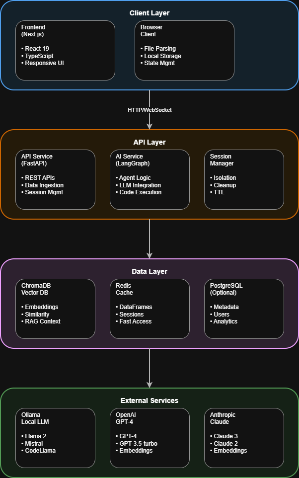

# Oil Drilling Data Analysis Dashboard

Author: Justice Owusu

## Demo Video
Watch the demo video: https://drive.google.com/file/d/11O4EBxYd5EMJTuMnKm6yLSjLMRnUB5ap/view?usp=sharing

A comprehensive fullstack AI-powered platform for oil drilling data analysis, featuring natural language queries, interactive visualizations, and intelligent insights. Upload drilling data and ask questions conversationally to unlock hidden patterns and correlations in your operational data.

## What It Does

Traditional oil drilling analysis relies on static spreadsheets and manual interpretation. This platform democratizes complex drilling data through:

- Conversational AI: Ask questions like "What were the drilling parameters during the stuck pipe incident?" or "Show me ROP trends in shale formations"
- Interactive Visualizations: Real-time charts for rock composition, sonic logs, gamma ray data, and more
- Intelligent Analysis: AI-powered pattern recognition and correlation identification
- Multi-Modal Support: Works with CSV, Excel, and structured drilling reports
- Streaming Responses: Real-time AI chat with Server-Sent Events
- Responsive Design: Optimized for desktop, tablet, and mobile devices

## Key Features

### AI-Powered Analysis
- Natural Language Queries: Ask questions in plain English about drilling data
- Contextual Understanding: AI trained on drilling terminology and operational concepts
- Streaming Chat: Real-time AI responses with Server-Sent Events
- Session-Based Analysis: Persistent data sessions with automatic cleanup
- Multi-Model Support: OpenAI GPT-4, Anthropic Claude, or local Ollama models (Llama, Mistral, etc.)
- Advanced Agent Processing: LangGraph-powered query analysis with code execution

### Data Visualization
- Interactive Charts: Real-time visualization of drilling parameters with synchronized depth scaling
- Multi-Chart Dashboard: Rock composition, sonic logs (DT), and gamma ray logs (GR)
- Responsive Grid Layout: Adaptive 1-3 column layout based on screen size
- Client-Side Processing: Instant Excel/CSV parsing with immediate preview
- Data Correlation: Consistent depth axis across all visualizations

### Enterprise Architecture
- Microservices Design: Scalable API, AI, and frontend services with Docker orchestration
- Dual Storage Strategy: ChromaDB for vector embeddings, Redis for DataFrame caching
- Session Isolation: Secure, per-user data sessions with automatic expiration
- Production Ready: Comprehensive logging, error handling, and health monitoring
- Type Safety: 100% TypeScript coverage with strict mode

## Architecture Overview



### High-Level Architecture

```
┌─────────────────┐    ┌─────────────────┐    ┌─────────────────┐
│   Frontend      │    │   API Service   │    │   AI Service    │
│   (Next.js)     │◄──►│   (FastAPI)     │◄──►│   (LangGraph)   │
│                 │    │                 │    │                 │
│ • File Upload   │    │ • Data Ingestion│    │ • Agent Workflow│
│ • Chat Interface│    │ • Session Mgmt  │    │ • Code Execution│
│ • Data Viz      │    │ • Vector Storage│    │ • Response Gen  │
└─────────────────┘    └─────────────────┘    └─────────────────┘
                               │                        │
                               ▼                        ▼
                    ┌─────────────────┐         ┌─────────────────┐
                    │   ChromaDB      │         │   Ollama/       │
                    │   (Embeddings)  │         │   OpenAI API    │
                    └─────────────────┘         └─────────────────┘
                               │
                               ▼
                    ┌─────────────────┐
                    │   Redis         │
                    │ (DataFrames)    │
                    └─────────────────┘
```

### Data Flow Architecture

**Ingestion Pipeline:**
File Upload → Client Parsing → API Service → Data Ingestion → Vector Storage + Redis Cache

**Query Processing:**
User Query → API Service → AI Agent → Classify → Retrieve → Generate → Execute → Stream Response

**Storage Strategy:**
- ChromaDB: Semantic search and embeddings for RAG (accessed by API service)
- Redis: Fast DataFrame access and session data caching (accessed by API service)
- Session Isolation: Per-user data sessions with automatic cleanup

For detailed architecture documentation including LangGraph workflows, see [ARCHITECTURE.md](ARCHITECTURE.md).

## Technology Stack

### Backend Services
- **FastAPI**: High-performance async web framework with automatic API documentation
- **LangChain/LangGraph**: LLM orchestration, RAG pipelines, and agent workflow management
- **ChromaDB**: Vector database for embeddings and semantic search
- **Redis**: High-performance caching and DataFrame storage
- **SQLAlchemy**: Database ORM with async support
- **Pydantic**: Data validation and serialization with v2 features

### Frontend Framework
- **Next.js 16**: React framework with App Router, server components, and edge runtime
- **React 19**: Latest React features with concurrent rendering and automatic batching
- **TypeScript 5**: Strict type checking with advanced language features
- **Tailwind CSS v4**: Utility-first CSS with modern features

### UI & Design System
- **shadcn/ui**: Production-ready component library built on Radix UI
- **Radix UI**: Unstyled, accessible component primitives
- **Recharts**: Declarative React charting library with D3.js foundation
- **Lucide React**: Consistent icon library with 1000+ icons
- **next-themes**: Theme switching with system preference detection

### State Management & Data Fetching
- **Zustand**: Lightweight state management with persistence middleware
- **TanStack Query**: Powerful server state management with caching
- **Local Storage API**: Browser storage with Zustand persistence

### AI & Data Processing
- **Ollama**: Local LLM server (Llama, Mistral, CodeLlama)
- **OpenAI/Anthropic**: Cloud LLM integration (GPT-4, Claude)
- **Pandas**: Data manipulation and analysis
- **xlsx/papaparse**: Client-side Excel and CSV processing
- **LangGraph Agents**: Complex multi-step AI workflows

### Development & Quality Tools
- **ESLint**: Advanced linting with Next.js and TypeScript rules
- **Prettier**: Opinionated code formatting
- **Docker**: Containerized deployment with multi-service orchestration
- **pnpm**: Fast, disk-efficient package manager

## 🚀 Quick Start

### Prerequisites
- **Docker & Docker Compose**
- **Git**

### Fullstack Deployment

1. **Clone the repository**
   ```bash
   git clone <repository-url>
   cd oil-drilling-dashboard
   ```

2. **Start the application**
   ```bash
   # Full stack with AI and database
   docker-compose --profile ai --profile db up -d

   # Or minimal stack (API + Frontend)
   docker-compose up -d
   ```

3. **Access the application**
   - **Frontend**: http://localhost:3000
   - **API**: http://localhost:8000
   - **API Docs**: http://localhost:8000/docs

### Development Setup

For development with hot reloading:

```bash
# Backend development
cd backend
docker-compose -f docker-compose.yml -f docker-compose.override.yml up -d

# Frontend development
cd frontend
pnpm install
pnpm dev
```

See [backend/README.md](backend/README.md) and [frontend/README.md](frontend/README.md) for detailed development instructions.

For comprehensive system architecture details, see [ARCHITECTURE.md](ARCHITECTURE.md).

For CI/CD pipeline documentation, see [CI-CD.md](CI-CD.md).

## 📊 Data Format

The platform accepts drilling data with these key columns:
- `depth`: Depth measurement (ft)
- `dt`: Sonic travel time (µs/ft)
- `gr`: Gamma ray (API)
- Rock composition: `sh`, `anh`, `ls`, `coal`, `salt`, `dol` (%)

**Supported formats**: Excel (.xlsx/.xls), CSV (.csv)

## API Overview

### Core Endpoints

#### Data Management
- `POST /drilling/upload` - Upload and process drilling data files
- `POST /drilling/query` - Query uploaded data with structured queries
- `GET /drilling/session/{session_id}` - Retrieve session information

#### AI Chat
- `POST /chat/` - Conversational AI queries with streaming support
- `GET /health` - Service health check endpoint

### Example Usage

```python
import requests

# Upload drilling data
files = {'file': open('drilling_data.xlsx', 'rb')}
response = requests.post('http://localhost:8000/drilling/upload', files=files)
data = response.json()
session_id = data['session_id']
print(f"Uploaded {data['filename']} with {data['num_columns']} columns")

# Query with AI agent
chat_request = {
    "session_id": session_id,
    "message": {
        "role": "user",
        "content": "What were the drilling parameters during the stuck pipe incident?"
    },
    "stream": False
}
response = requests.post('http://localhost:8000/chat/', json=chat_request)
print(response.json()['message']['content'])

# Get session info
session_info = requests.get(f'http://localhost:8000/drilling/session/{session_id}')
print(session_info.json())
```

See [backend/README.md](backend/README.md) for complete API documentation and [frontend/README.md](frontend/README.md) for client-side integration details.

## Configuration

### Backend Environment Variables

Create a `.env` file in the backend directory:

```bash
# Application Settings
DEBUG=false
SECRET_KEY=your-secret-key-here

# AI Service Configuration
AI_MODEL_PROVIDER=ollama  # or "openai" or "anthropic"
AI_OLLAMA_BASE_URL=http://ollama:11434
AI_OLLAMA_MODEL=llama2
AI_OLLAMA_EMBEDDING_MODEL=nomic-embed-text
AI_OPENAI_API_KEY=your-openai-key-here
AI_OPENAI_MODEL=gpt-4
AI_ANTHROPIC_API_KEY=your-anthropic-key-here
AI_VOYAGE_API_KEY=your-voyage-key-here

# Database (Optional)
DATABASE_URL=sqlite:///./drilldata.db
POSTGRES_PASSWORD=your-postgres-password

# Redis Configuration
REDIS_URL=redis://localhost:6379
UPSTASH_REDIS_REST_URL=your-upstash-url
UPSTASH_REDIS_REST_TOKEN=your-upstash-token

# RAG Settings
AI_RAG_MAX_CHUNKS=5
AI_RAG_CHUNK_OVERLAP=200
```

### Frontend Environment Variables

Create a `.env.local` file in the frontend directory:

```bash
# API Configuration
NEXT_PUBLIC_API_BASE_URL=http://localhost:8000
```

### Model Configuration

**Local Models (Ollama):**
- Install Ollama and pull preferred models
- Set `AI_MODEL_PROVIDER=ollama`
- Configure model names in environment variables

**Cloud Models (OpenAI/Anthropic):**
- Obtain API keys from respective providers
- Set appropriate `AI_MODEL_PROVIDER`
- Configure API keys and model names

## Testing

```bash
# Backend tests
cd backend
pytest

# Frontend tests (when implemented)
cd frontend
pnpm test

# With coverage
cd backend
pytest --cov=services --cov-report=html
```

## Security & Privacy

- Session Isolation: Each upload creates isolated data sessions with unique identifiers
- Automatic Cleanup: Sessions expire after 24 hours with automatic data removal
- No Permanent Storage: Uploaded data is not persisted long-term beyond session lifetime
- Environment Variables: Sensitive API keys and configuration stored securely
- Type Safety: 100% TypeScript coverage prevents runtime errors and injection attacks
- CORS Configuration: Properly configured cross-origin resource sharing

## Contributing

1. Fork the repository
2. Create a feature branch (`git checkout -b feature/amazing-feature`)
3. Commit your changes (`git commit -m 'Add amazing feature'`)
4. Push to the branch (`git push origin feature/amazing-feature`)
5. Open a Pull Request

### Development Guidelines

**Backend:**
- Black formatter for consistent code style
- isort for import organization
- Minimum 80% test coverage
- Type hints and docstrings required

**Frontend:**
- ESLint with Next.js configuration
- Prettier for code formatting
- TypeScript strict mode enabled
- Component composition over inheritance

**General:**
- Update READMEs for new features
- Follow conventional commit format
- Ensure responsive design principles
- Test across different screen sizes

## License

This project is licensed under the MIT License - see the [LICENSE](LICENSE) file for details.

## Acknowledgments

- LangChain and LangGraph for LLM orchestration and agent workflows
- ChromaDB for reliable vector database functionality
- Redis for high-performance caching and data storage
- Ollama for making local LLMs accessible
- OpenAI and Anthropic for cloud LLM capabilities
- FastAPI for the exceptional async web framework
- Next.js for the powerful React framework with App Router
- shadcn/ui for the beautiful and accessible component library
- TanStack Query for advanced data fetching and caching
- Recharts for the comprehensive charting capabilities

---

Oil Drilling Data Analysis Dashboard - Transforming drilling data analysis through conversational AI, advanced agent processing, and interactive visualization.
